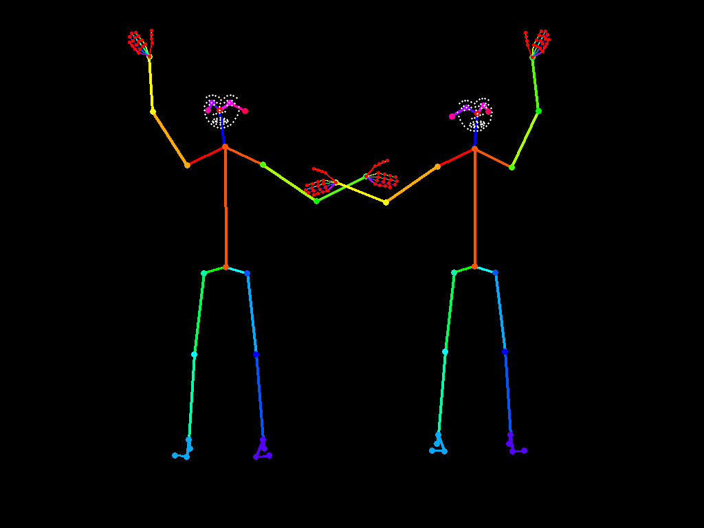

# DiffusedFrames USD Pose Bridge

[](https://github.com/diffusedframes/comfyui-usd-pose-bridge/actions/workflows/tests.yml)

**A first custom node pack for turning OpenUSD skeleton animation into camera-matched OpenPose conditioning.**

Load a USD scene, pick its camera, and generate pose images and editable keypoint data directly from the rig. No pose detector, model download, Blender, or GPU renderer is needed.

**Development preview · 0.1.0.** Backend integration tests and the bundled demo are available; an interactive ComfyUI Desktop installation check is still pending. Comfy Registry / Manager registration is pending, so install manually for now.



## What is included

- Authored USD camera projection, including camera animation, perspective/orthographic views, aperture offsets, and fit/crop framing.
- Animated UsdSkel evaluation, composed character transforms, and multiple characters in one image.
- COCO 18 and BODY 25 body layouts; hand landmarks when corresponding finger joints exist; explicit face landmark mapping.
- Conservative automatic joint naming for common Mixamo, Blender, Unreal, and semantic rig names, with precise JSON overrides.
- Image batches for animation and `POSE_KEYPOINT` data using the frame-list convention used by ComfyUI ControlNet Auxiliary.
- Mapping reports that expose missing and ambiguous joints, JSON import, and sequence/per-frame JSON export.
- An animated two-character USD scene, importable workflows, and executable integration tests.

## Install

Use the `custom_nodes` folder and Python environment belonging to the **same ComfyUI installation**. Desktop can manage several installations, so select the one you want to use first. Installing dependencies in system Python will not make them available to ComfyUI. See the [official dependency installation guide](https://docs.comfy.org/basic-concepts/custom-nodes#2-installing-node-dependencies).

### ComfyUI Desktop on Windows

1. Open the selected installation's folder and Desktop terminal. This folder should contain `custom_nodes` and `.venv`; it is separate from the Desktop application program folder. Older Desktop installations commonly use `%USERPROFILE%\Documents\ComfyUI`; use your configured location if it differs.
2. Put this pack in `custom_nodes\comfyui-usd-pose-bridge`. You can download and extract the [repository ZIP](https://github.com/diffusedframes/comfyui-usd-pose-bridge/archive/refs/heads/main.zip), renaming the extracted folder to `comfyui-usd-pose-bridge`, or clone the repository:

```powershell
git clone https://github.com/diffusedframes/comfyui-usd-pose-bridge.git ".\custom_nodes\comfyui-usd-pose-bridge"
```

3. In the Desktop terminal, set the full path of that installation folder. Replace the example below with your selected folder. First preview the dependency changes:

```powershell
$comfyRoot = "C:\path\to\your\ComfyUI"
$comfyPython = Join-Path $comfyRoot ".venv\Scripts\python.exe"
$packRequirements = Join-Path $comfyRoot "custom_nodes\comfyui-usd-pose-bridge\requirements.txt"
uv pip install --python "$comfyPython" --dry-run -r "$packRequirements"
```

4. Install the requirements, then restart the selected ComfyUI installation:

```powershell
uv pip install --python "$comfyPython" -r "$packRequirements"
```

`uv` is supplied with Desktop; use its terminal if it is unavailable in your usual shell. These commands explicitly target Desktop's existing `.venv` and do not require pip inside it. Do not create a replacement environment or use a global `pip install`. Find the nodes under **DiffusedFrames → USD Pose** after restarting.

### Windows portable or a manual installation

For Windows portable, run these commands from the portable distribution's top-level folder. The first command previews changes:

```powershell
.\python_embeded\python.exe -m pip install --dry-run -r ".\ComfyUI\custom_nodes\comfyui-usd-pose-bridge\requirements.txt"
.\python_embeded\python.exe -m pip install -r ".\ComfyUI\custom_nodes\comfyui-usd-pose-bridge\requirements.txt"
```

For a manual installation with an existing `.venv`, run from the ComfyUI folder:

```powershell
.\.venv\Scripts\python.exe -m pip install --dry-run -r ".\custom_nodes\comfyui-usd-pose-bridge\requirements.txt"
.\.venv\Scripts\python.exe -m pip install -r ".\custom_nodes\comfyui-usd-pose-bridge\requirements.txt"
```

Use your installation's actual interpreter path if it differs; on Linux/macOS, an existing virtual environment normally uses `.venv/bin/python`. Restart ComfyUI after installation.

Runtime requirements are `usd-core`, NumPy, and Pillow. ComfyUI supplies Torch; the pack's runtime requirements do not request Torch or CUDA changes. Other packages may be added or updated if your installed versions do not satisfy the requirements; the dry run shows the proposed changes. `usd-core` must offer a wheel for your Python/platform. Backend checks currently exercise Python 3.12 and OpenUSD 26.8 on Windows.

### OpenUSD import troubleshooting

A separate USD SDK on `PYTHONPATH` can shadow the `usd-core` wheel, and incompatible SDK DLLs on `PATH` can cause import errors. Start ComfyUI without that SDK environment, or keep different USD builds in separate processes. Avoid mixing a standalone SDK and a wheel in one Python process. A missing or incompatible OpenUSD runtime is reported when the USD node executes.

## Try the demo

Drag `examples/workflow_still.json` into ComfyUI and run it. It loads `examples/demo.usda` from this pack, previews the pose, displays the scene report, and saves pose JSON under `ComfyUI/output/usd_pose/`.

Use `examples/workflow_animation.json` for 24 consecutive frames. Each batch image and keypoint frame has the same index. API prompt versions are included beside the UI workflows.

The basic connection is:

```text
Load USD Stage → USD to OpenPose → Preview Image
                         ├──────→ Apply ControlNet (image input)
                         └──────→ Save OpenPose JSON
```

Connect `pose_images` to the `image` input of your existing Apply ControlNet node and use a pose-compatible ControlNet model. `POSE_KEYPOINT` outputs connect to compatible keypoint tools; they are data rather than conditioning objects. The demo itself requires no diffusion model or other custom pack.

## Use your scene

Set **Load USD Stage → stage_path** to an absolute server-local `.usd`, `.usda`, `.usdc`, or `.usdz` path. Other relative paths resolve under `ComfyUI/input`. The special `examples/` prefix resolves under this pack, keeping bundled workflows portable.

Run **Inspect USD Stage** to see camera paths, skeleton paths, joint names, units, and time range. In **USD to OpenPose**:

| Setting | Behavior |
| --- | --- |
| `camera_path` | Blank automatically selects a single camera; scenes with several cameras require an exact prim path. |
| `skeleton_paths` | `*` selects all skeletons. Otherwise use comma-separated absolute prim paths. |
| `start_frame` / `frame_count` / `frame_step` | USD time-code samples, including fractional samples. Count 1 produces a still. |
| `width` / `height` | Output canvas size. |
| `camera_fit` | `fit` expands the camera gate to the canvas; `crop` fills the canvas by cropping the gate. |
| `pose_format` | `COCO_18` is the default for common pose conditioning. `BODY_25` adds pelvis and feet. |
| `coordinate_space` | `normalized` uses 0–1 coordinates, matching Auxiliary OpenPose outputs; `pixel` uses output-image pixels. |
| `draw_hands` / `draw_face` | Rendering switches; mapped keypoints remain present in the data output. |

Times are **USD time codes**, not seconds. Sampling begins at `start_frame`; set it to the source scene's start time when that is not 1. `time_codes_per_second` is included in each output frame. Sampling outside an authored animation range follows USD's held-value behavior.

See [joint mapping](docs/joint-mapping.md) for custom rigs and [technical notes](docs/technical-notes.md) for conventions and limits.

## Nodes

| Node | Outputs |
| --- | --- |
| Load USD Stage | `USD_STAGE`, scene information |
| Inspect USD Stage | Scene information, displayed on the node after execution |
| USD Joint Map | Validated custom mapping |
| USD to OpenPose | `IMAGE` batch, `POSE_KEYPOINT` frame list, mapping report |
| Render OpenPose | `IMAGE` batch from keypoint data |
| Load OpenPose JSON | Keypoint data from a single frame or sequence |
| Save OpenPose JSON | Saved file paths; never overwrites existing exports |

**Load OpenPose JSON** supports COCO 18 and BODY 25. Width and height supply missing canvas dimensions; existing file dimensions take precedence. Choose a coordinate convention explicitly if an external file omits it and automatic detection is ambiguous. `sequence` export writes a list of frames; `per_frame` writes one frame object per numbered file. Exports preserve the selected coordinate convention; choose `pixel` when a downstream application expects pixel coordinates.

## Current limits

This release bridges **USD → OpenPose** and OpenPose JSON/image workflows. It does not reconstruct or retarget a 3D rig from a 2D pose. It reads actual `UsdSkel.Skeleton` data; a mesh without an exported skeleton cannot supply joint positions. It has no embedded 3D editor yet.

Visibility uses the camera frustum and clipping planes. Mesh/self occlusion and depth ordering are not evaluated. Missing facial or finger landmarks remain missing. Body naming support is heuristic, not a guarantee for every rig; inspect the mapping report and use overrides. A batch is limited to 32 million output pixels; process longer clips in chunks.

## Development

These commands create a **separate development environment in this repository**. They are not installation instructions for an existing ComfyUI Desktop environment.

```powershell
uv venv .venv
uv pip install --python .venv\Scripts\python.exe -e ".[test]"
.venv\Scripts\python.exe -m pytest
```

`examples/create_demo.py` rebuilds the authored USD scene; `examples/render_demo.py` regenerates its preview and animation through the actual node implementations. Source files are never saved by the reader. Each loader run refreshes non-dirty file-backed USD layers, including references; shared dirty layers are rejected to protect unsaved edits. See the technical notes before sharing a USD runtime with another editing extension.

Implemented against the official [ComfyUI node contract](https://docs.comfy.org/custom-nodes/backend/server_overview), [image tensor convention](https://docs.comfy.org/custom-nodes/backend/images_and_masks), [OpenUSD skeletal APIs](https://openusd.org/dev/api/_usd_skel__a_p_i__intro.html), and [ControlNet Auxiliary keypoint interchange](https://github.com/comfyorg/comfyui-controlnet-aux/blob/main/node_wrappers/openpose.py). No detector implementation or model weights are bundled.

## Support and license

Report bugs and feature requests in [this pack's issues](https://github.com/diffusedframes/comfyui-usd-pose-bridge/issues). Include the ComfyUI version, installation type, operating system, error text, and a minimal workflow or scene you can share.

Part of [DiffusedFrames](https://github.com/diffusedframes). Distributed under the [MIT License](LICENSE).
