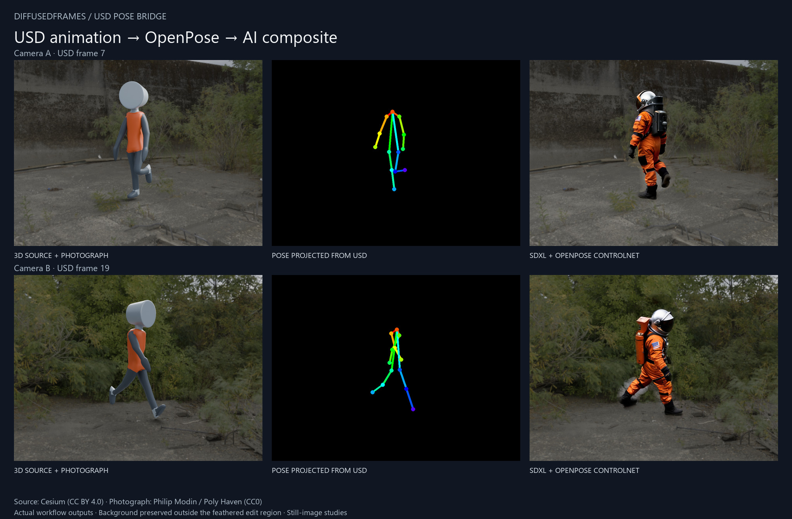

# Industrial runner: a real-asset USD shot

This example starts with an animated, skinned character and authored cameras in
OpenUSD. The pose controls come directly from the rig and camera, without running
a pose detector on the rendered image. The backgrounds are actual panoramic
photography. Both cameras and the full original two-second running cycle are in
`shot.usdc`.

| Case | USD camera | Frame | Matching files |
| --- | --- | --- | --- |
| A | `/World/Camera_A/Camera_A` | 7 | `source_A.png`, `plate_A.png`, `mask_A.png` |
| B | `/World/Camera_B/Camera_B` | 19 | `source_B.png`, `plate_B.png`, `mask_B.png` |

Use a **1024 × 768** canvas, **fit** camera framing, and the supplied
`joint_map.json`. The skeleton is `/World/Performer/RunnerRig/Armature`. The stage
runs from frame **1 through 48**, at **24 frames per second**, in meters with Z
up. `scene_info.json` contains the same settings in a machine-readable form.

The `source` images show the 3D performer against the photographed location. The
`plate` images contain the matching empty background. White in each `mask` is the
performer's silhouette; black is the background. Each group is rendered through
the same camera at the same frame. A workflow may grow and soften the silhouette
before using it for inpainting. A different frame or camera needs its own matching
plate and mask.

## What the example demonstrates

- A real imported rig with its original animation, rather than fabricated pose
  coordinates.
- Explicit mapping of a character's nonstandard joint names.
- Camera-aware projection with two distinct views and animation frames.
- Reusable OpenPose controls for changing the performer's appearance while
  preserving the selected shot's framing and photographic background.

This character has 19 skeletal joints. Its rig provides body landmarks, but no
nose, eye, ear, finger, or facial landmarks. Those are deliberately left missing.
COCO-18 exports 13 available body points; BODY-25 additionally includes the mapped
pelvis point. The mesh is a simple stylized performer, not a photoreal human scan.
The pack does not render the mesh or background: Blender created these reference
images, and the pack reads the USD skeleton and camera to produce pose controls.

## Run the cinematic example in ComfyUI

1. Install this pack and its normal runtime requirements.
2. Copy `plate_A.png`, `plate_B.png`, `mask_A.png`, and `mask_B.png` from this
   folder to your ComfyUI installation's `input/diffusedframes_showcase/` folder.
3. Load `examples/workflow_showcase.json` for case A or
   `examples/workflow_showcase_B.json` for case B.
4. Select an SDXL checkpoint and a matching SDXL OpenPose ControlNet in their
   loaders, then run the workflow. The default model file names are listed below.

The recorded results use `Juggernaut-XL_v9_RunDiffusionPhoto_v2.safetensors` and
[xinsir/controlnet-openpose-sdxl-1.0](https://huggingface.co/xinsir/controlnet-openpose-sdxl-1.0).
Download the ControlNet's `diffusion_pytorch_model.safetensors` into
`models/controlnet/SDXL/`, naming it `xinsir-openpose-sdxl-1.0.safetensors` to
match the preset. It is a separate 2.5 GB model, distributed by its author under
Apache 2.0; it is not included in this pack. The recorded model revision is
`23f966cd5cfdd3f7729c903e243d87152162d2b7`, SHA-256
`b8524e557a7df60d081f5d4a0eb109967d107df217943bf88c2d99b9ebcc06c5`.
Another compatible SDXL checkpoint may produce a different appearance.

The workflow projects the actual USD skeleton, thresholds the supplied silhouette
to remove render noise, grows and feathers that mask, and uses the pose to guide
inpainting. Its final composite keeps the original photograph outside the edit
region. Both cases were executed in ComfyUI Desktop; saved background pixels
outside the mask match the source within one 8-bit code value from quantization.
The pose, JSON, edit mask, and final image are saved separately for inspection.

These are **still-image studies**. They do not demonstrate temporally consistent
AI video, facial performance, or finger tracking. The chosen rig has no such
landmarks. A new camera or frame needs matching plate/mask images; use the Blender
rebuild script to prepare a new case.

The paired API request bodies are `examples/api_showcase.json` and
`examples/api_showcase_B.json`. `tools/create_showcase_workflow.py` regenerates
both UI/API versions from `scene_info.json` and `joint_map.json`.

## Credits and licenses

**Cesium Man**: © 2017 Cesium, licensed under
[Creative Commons Attribution 4.0 International](https://creativecommons.org/licenses/by/4.0/).
Source: [Khronos glTF Sample Assets / CesiumMan](https://github.com/KhronosGroup/glTF-Sample-Assets/tree/main/Models/CesiumMan).
DiffusedFrames converted the model and original animation to OpenUSD, changed its
scale, and replaced every source material with graphite, orange, and silver
materials. The Cesium logo texture is not used or distributed in this example.
The character geometry, rig, and animation remain available under CC BY 4.0;
the repository's code license does not replace that asset license. No endorsement
by Cesium is implied.

**Abandoned Slipway**: panoramic photography by **Philip Modin**, provided by
[Poly Haven](https://polyhaven.com/a/abandoned_slipway) under
[CC0](https://creativecommons.org/publicdomain/zero/1.0/).
The photographic background and environment lighting are rendered from this
HDRI. The original HDRI is downloaded into the development cache and is not
required to open the bundled USD or run the ComfyUI workflows.

## Rebuilding

Run Blender 5.2 or later in background mode with
`tools/create_showcase.py`. That script downloads the original public sources
into `dist/showcase_source`, replaces all source materials, exports the USD, and
renders both matching sets. Blender and the original HDRI are needed only to
rebuild these assets, not to use the node pack.
